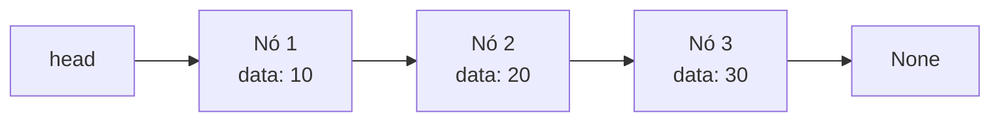
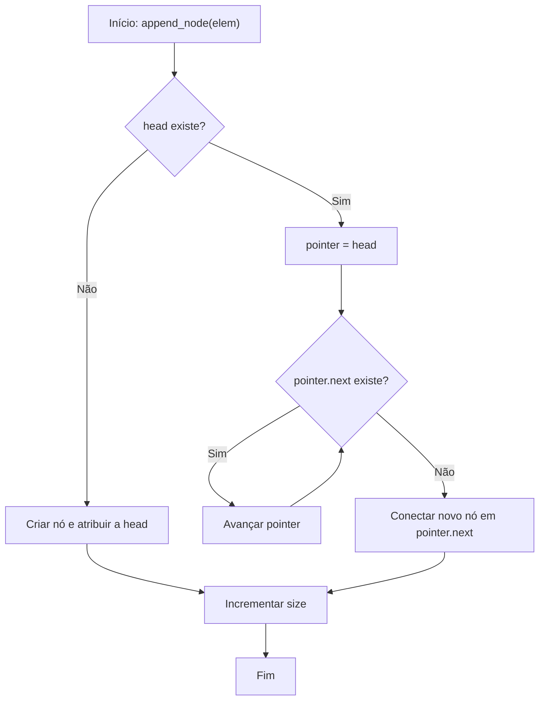
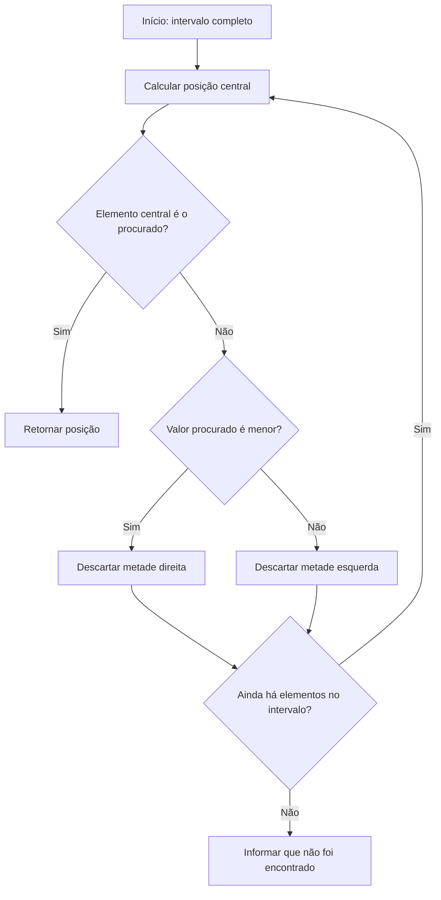
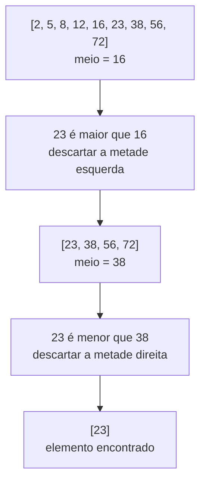
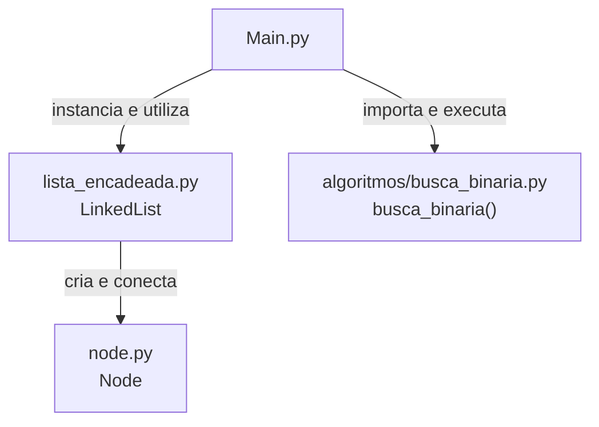
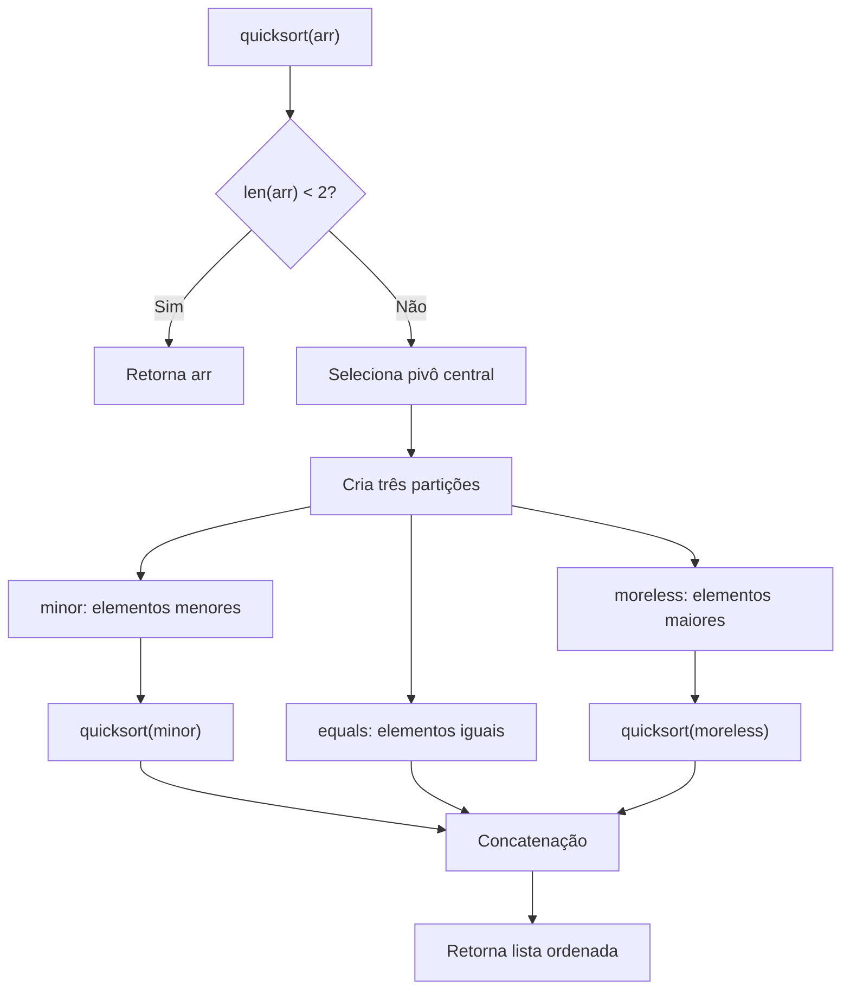
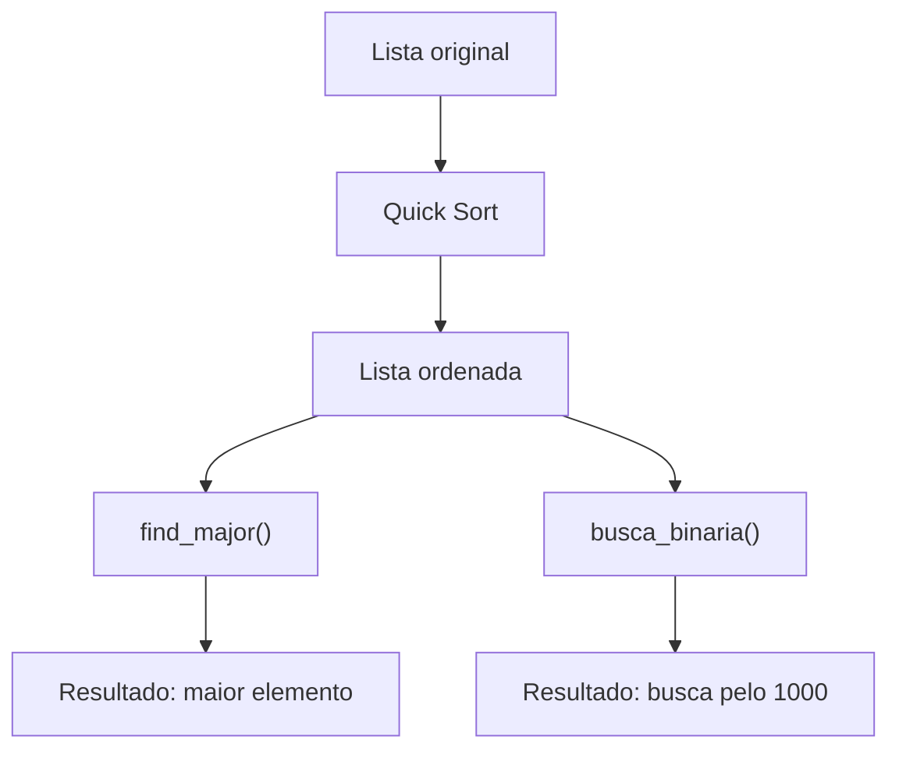

# Estruturas de Dados e Algoritmos em Python

> Repositório de estudos dedicado à implementação prática de estruturas de dados e algoritmos utilizando Python.

Este projeto tem como objetivo consolidar conceitos fundamentais de Ciência da Computação por meio da implementação manual de estruturas de dados, da análise de seu funcionamento e da experimentação com diferentes operações.

O foco não está apenas em utilizar estruturas prontas da linguagem, mas em compreender como elas funcionam internamente: organização dos elementos, referências entre objetos, percursos, inserções, remoções e custo computacional.

## Objetivos

- Estudar estruturas de dados fundamentais por meio de implementações próprias.
- Compreender a relação entre lógica de programação, orientação a objetos e organização de dados.
- Implementar e testar algoritmos de busca.
- Analisar a complexidade de tempo e espaço utilizando a notação Big O.
- Registrar a evolução do projeto e aprimorar as implementações progressivamente.

## Tecnologias

- **Linguagem:** Python 3
- **Paradigma:** programação orientada a objetos
- **Controle de versão:** Git e GitHub

## Organização do repositório

```text
estruturas_data/
├── algoritmos/
│   └── busca_binaria.py
├── Main.py
├── lista_encadeada.py
├── node.py
└── README.md
```

A árvore acima representa a organização esperada a partir dos arquivos identificados no repositório. Confira os nomes e caminhos diretamente na pasta `algoritmos/`, pois a listagem do diretório não ficou acessível durante a elaboração desta documentação.

---

# 1. Estruturas de dados

## 1.1 Lista simplesmente encadeada (Singly Linked List)

**Arquivo:** `lista_encadeada.py`  
**Classe:** `LinkedList`

Uma lista simplesmente encadeada é uma estrutura de dados linear e dinâmica na qual cada elemento é armazenado em um nó (*node*). Diferentemente de um vetor ou de uma lista convencional do Python, os elementos não precisam ocupar posições consecutivas na memória.

Cada nó armazena:

1. Um valor (`data`).
2. Uma referência para o próximo nó (`next`).

A estrutura mantém uma referência chamada `head`, que aponta para o primeiro nó. A partir dela, é possível percorrer toda a lista seguindo as referências `next`.

### Representação



Cada nó guarda seu dado e uma referência para o próximo nó. O último nó aponta para `None`, indicando o fim da lista.

### Classe Node

**Arquivo:** `node.py`

A classe `Node` representa a unidade básica da lista encadeada.

```python
class Node:
    def __init__(self, data):
        self.data = data
        self.next = None
```

| Atributo | Responsabilidade |
|---|---|
| `data` | Armazena o valor do nó. |
| `next` | Guarda a referência para o próximo nó. Inicialmente, é `None`. |

A separação entre `Node` e `LinkedList` permite que a lista utilize nós sem concentrar toda a lógica de armazenamento em uma única classe.

### Classe LinkedList

A classe `LinkedList` administra os nós e disponibiliza operações para manipular a estrutura.

#### `__init__()`

Inicializa uma lista vazia.

```python
def __init__(self):
    self.head = None
    self.size = 0
```

- `head`: referência para o primeiro nó. Quando vale `None`, a lista está vazia.
- `size`: contador da quantidade de elementos.

**Complexidade:** O(1).

#### `append_node(elem)`

Adiciona um novo elemento ao final da lista.

Funcionamento:

1. Verifica se já existe um primeiro nó.
2. Se existir, começa o percurso em `head`.
3. Avança enquanto `pointer.next` não for `None`.
4. Ao encontrar o último nó, conecta o novo nó em `pointer.next`.
5. Se a lista estiver vazia, o novo nó passa a ser `head`.
6. Atualiza o contador `size`.

```python
def append_node(self, elem):
    if self.head:
        pointer = self.head

        while pointer.next:
            pointer = pointer.next

        pointer.next = Node(elem)
    else:
        self.head = Node(elem)

    self.size += 1
```

**Fluxo simplificado:**



**Complexidade:**

- Lista vazia: O(1).
- Lista não vazia: O(n), pois pode ser necessário percorrer todos os nós.
- Espaço auxiliar: O(1), desconsiderando o novo nó criado.

Uma possível otimização futura é manter também uma referência para o último nó (`tail`). Assim, a inserção ao final pode ser realizada em O(1).

#### `see_list()`

Percorre a lista e imprime os valores armazenados.

```python
def see_list(self):
    pointer = self.head

    while pointer:
        print(pointer.data)
        pointer = pointer.next
```

O percurso começa em `head` e avança por meio de `pointer.next` até encontrar `None`.

**Complexidade:** O(n) em tempo e O(1) em espaço auxiliar.

#### `search(elem)`

Procura um valor na lista e retorna o índice da primeira ocorrência encontrada.

```python
def search(self, elem):
    pointer = self.head
    cont = 0

    while pointer:
        if pointer.data == elem:
            print(f"valor '{elem}' encontrado no indice : {cont}\n")
            return cont

        pointer = pointer.next
        cont += 1

    print(" valor não encontrado !")
```

A variável `pointer` percorre os nós, enquanto `cont` registra a posição lógica do elemento.

Se o valor estiver presente, o método retorna seu índice. Caso contrário, percorre toda a lista e termina sem retornar um índice.

**Complexidade:**

- Melhor caso: O(1), quando o elemento está no primeiro nó.
- Caso médio: O(n).
- Pior caso: O(n), quando o elemento está no último nó ou não existe.
- Espaço auxiliar: O(1).

**Observação:** como o método retorna a primeira ocorrência, valores duplicados não são todos identificados. Uma evolução possível seria retornar uma lista com todos os índices encontrados.

#### `get(index)`

Percorre a lista para localizar e exibir o valor presente em determinado índice.

```python
def get(self, index):
    pointer = self.head
    cont = -1

    try:
        while cont != index:
            cont += 1

            if index == cont:
                print(f"valor encontrado no indice {index} é '{pointer.data}'")
                break
            else:
                pointer = pointer.next

    except AttributeError:
        print("indice não encontrado nos nodes..")
```

O método começa com `cont = -1` e avança o contador até alcançar o índice solicitado. A cada avanço, a referência `pointer` também percorre a lista.

Se o percurso ultrapassar o último nó, o acesso a um atributo de `None` pode gerar `AttributeError`, que é tratado pelo `except`.

**Complexidade:** O(n) em tempo e O(1) em espaço auxiliar.

**Observações sobre a implementação atual:**

- O método imprime o valor, mas não o retorna. Retornar o dado (por exemplo, com `return pointer.data`) tornaria a operação mais reutilizável.
- Índices negativos não são tratados explicitamente.
- É recomendável validar o índice antes do percurso, evitando utilizar exceções como fluxo normal de controle.

#### `transform(arr)`

Insere os elementos de um iterável na lista, utilizando `append_node()`.

```python
def transform(self, arr):
    for i in arr:
        self.append_node(i)
```

O método percorre os elementos de `arr` e adiciona cada um ao final da lista.

**Complexidade da implementação atual:** O(n²) no pior caso para uma lista inicialmente vazia, pois cada inserção percorre os nós já adicionados.

Para `n` elementos, o custo acumulado do percurso é proporcional a:

\[
0 + 1 + 2 + \dots + (n-1) = \frac{n(n-1)}{2}
\]

Uma implementação com referência `tail` poderia reduzir a construção para O(n).

#### `del_node(elem)`

Remove da lista a primeira ocorrência de um elemento.

```python
def del_node(self, elem):
    pointer = self.head
    previous = None

    if elem == pointer.data:
        self.head = pointer.next
    else:
        while pointer:
            if pointer.data == elem:
                previous.next = pointer.next
                break

            previous = pointer
            pointer = pointer.next

    self.size -= 1
```

A remoção utiliza duas referências:

- `pointer`: aponta para o nó que está sendo analisado.
- `previous`: aponta para o nó anterior ao atual.

Quando o elemento é encontrado, a referência do nó anterior é atualizada para apontar diretamente para o próximo nó. Dessa maneira, o nó removido deixa de fazer parte da cadeia.

Há um tratamento separado para a remoção do primeiro elemento: nesse caso, `head` passa a apontar para o segundo nó.

**Complexidade:**

- Melhor caso: O(1), quando o elemento está no início.
- Caso médio: O(n).
- Pior caso: O(n), quando é necessário percorrer toda a lista.
- Espaço auxiliar: O(1).

**Pontos de atenção na implementação atual:**

- Se a lista estiver vazia, `pointer` será `None` e o acesso a `pointer.data` provocará `AttributeError`.
- Se o elemento não existir, `size` ainda será decrementado.
- Se houver valores duplicados, somente a primeira ocorrência será removida.
- A remoção do primeiro nó e a remoção dos demais deveriam atualizar `size` somente quando uma remoção realmente acontecer.

Esses pontos são oportunidades de melhoria e não devem ser confundidos com funcionalidades já corrigidas.

#### `__len__()`

Permite utilizar `len()` com objetos da classe `LinkedList`.

```python
def __len__(self):
    return self.size
```

O método retorna o contador mantido pela própria estrutura.

**Complexidade:** O(1), pois não percorre os nós.

É importante manter `size` consistente em todas as operações de inserção e remoção.

### Complexidade geral da lista encadeada

Considerando a implementação atual:

| Operação | Complexidade | Justificativa |
|---|---:|---|
| Inicialização | O(1) | Inicializa duas referências/variáveis. |
| Inserção no início | O(1) | Atualiza `head` (não há método específico no código atual). |
| Inserção no final | O(n) | Percorre a lista até o último nó. |
| Busca | O(n) | Pode percorrer todos os nós. |
| Acesso por índice (`get`) | O(n) | Não existe acesso direto por posição. |
| Remoção por valor | O(n) | Precisa localizar o nó e seu anterior. |
| Percorrer/imprimir | O(n) | Visita cada nó uma vez. |
| Consultar tamanho (`len`) | O(1) | Utiliza o contador `size`. |

> A tabela apresenta custos assintóticos. O resultado real depende também do tamanho dos dados e das operações executadas.

---

# 2. Algoritmos de busca

## 2.1 Busca binária (Binary Search)

**Arquivo esperado:** `algoritmos/busca_binaria.py`  
**Importação utilizada em:** `Main.py`

A busca binária é um algoritmo de pesquisa que reduz progressivamente o intervalo no qual um elemento pode estar localizado.

Diferentemente da busca linear, que verifica os elementos um por um, a busca binária compara o valor procurado com o elemento central do intervalo.

### Pré-requisito

**A coleção precisa estar ordenada** de acordo com a mesma regra utilizada nas comparações do algoritmo.

Sem essa condição, descartar metade do intervalo pode eliminar a região onde o elemento realmente está.

### Funcionamento conceitual

Considere a sequência:

```text
[2, 5, 8, 12, 16, 23, 38, 56, 72]
```

Procurando o valor `23`:

1. O algoritmo identifica o elemento central.
2. Compara o valor central com `23`.
3. Se o valor procurado for maior, descarta a metade esquerda.
4. Se for menor, descarta a metade direita.
5. Repete o processo até encontrar o elemento ou esgotar o intervalo.

A cada etapa, aproximadamente metade dos elementos restantes é descartada.



**Exemplo de redução do intervalo** ao procurar `23` na sequência ordenada:



### Complexidade teórica

| Cenário | Complexidade |
|---|---:|
| Melhor caso | O(1) |
| Caso médio | O(log n) |
| Pior caso | O(log n) |
| Espaço auxiliar — versão iterativa | O(1) |
| Espaço auxiliar — versão recursiva | O(log n), devido à pilha de chamadas |

### Uso no projeto

O arquivo `Main.py` importa a função e a utiliza sobre a coleção `lista_esquesita`:

```python
from algoritmos.busca_binaria import busca_binaria

print(busca_binaria(lista_esquesita, "Amor"))
```

A chamada demonstra a utilização da busca binária sobre uma lista de strings. Para que o resultado seja confiável, os elementos devem estar ordenados segundo a mesma ordem lexicográfica adotada pelas comparações da função.

**Limitação da documentação:** a implementação interna de `busca_binaria.py` não ficou acessível na consulta ao repositório. Portanto, esta seção descreve o funcionamento teórico do algoritmo e sua utilização identificada em `Main.py`, sem afirmar detalhes específicos sobre variáveis, retornos ou estratégia interna do seu código.

---

# 3. Visão geral do projeto

O diagrama abaixo resume a relação entre o programa principal, a estrutura de lista encadeada e o algoritmo de busca, conforme os arquivos e usos descritos neste README.



# 4. Execução e demonstração

## Arquivo `Main.py`

O arquivo principal demonstra a utilização das implementações do projeto.

No código identificado, o fluxo é:

1. Importa a classe `LinkedList`.
2. Instancia uma lista encadeada.
3. Cria uma lista Python com strings.
4. Utiliza `transform()` para inserir os elementos na lista encadeada.
5. Insere mais um elemento com `append_node()`.
6. Utiliza `get()` para consultar um índice.
7. Importa e executa a busca binária sobre a lista original.

Exemplo das operações identificadas:

```python
from lista_encadeada import LinkedList

Llist = LinkedList()

dados = ["Ana", "Bruno", "Carlos"]

Llist.transform(dados)
Llist.append_node("Daniel")

print(len(Llist))
```

O trecho acima é um exemplo ilustrativo de utilização da classe, não uma reprodução integral do `Main.py`.


## 2.2 Quick Sort (Ordenação Rápida)

**Arquivo:** `src/algoritmos/quicksort.py`  
**Algoritmo:** Quick Sort  
**Estratégia:** Divisão e Conquista (*Divide and Conquer*)  
**Implementação:** Recursiva com particionamento em três grupos.

O Quick Sort é um algoritmo de ordenação baseado na estratégia de divisão e conquista. Seu funcionamento consiste em selecionar um elemento denominado **pivô** e dividir os demais elementos em três grupos:

- **Menores (`minor`):** elementos menores que o pivô.
- **Iguais (`equals`):** elementos iguais ao pivô.
- **Maiores (`moreless`):** elementos maiores que o pivô.

Após a separação, o algoritmo aplica recursivamente o Quick Sort aos grupos de elementos menores e maiores. Finalmente, concatena os resultados para produzir uma sequência ordenada.

### Implementação no projeto

```python
def quicksort(arr):
    if len(arr) < 2:
        return arr

    pivot = arr[len(arr) // 2]
    equals = [x for x in arr if x == pivot]
    minor = [x for x in arr if x < pivot]
    moreless = [x for x in arr if x > pivot]

    return quicksort(minor) + equals + quicksort(moreless)
```

### Explicação do código

**1. Caso-base**

```python
if len(arr) < 2:
    return arr
```

Verifica se a lista possui menos de dois elementos. Nesse caso, ela já está ordenada, não sendo necessário continuar a recursão.

**2. Escolha do pivô**

```python
pivot = arr[len(arr) // 2]
```

Seleciona o elemento localizado no índice central da lista.

O operador `//` realiza divisão inteira, garantindo que o índice seja um número inteiro.

**3. Particionamento**

```python
equals = [x for x in arr if x == pivot]
minor = [x for x in arr if x < pivot]
moreless = [x for x in arr if x > pivot]
```

Utiliza *list comprehensions* para construir três novas listas:

- `equals`: armazena todas as ocorrências do pivô.
- `minor`: armazena os elementos menores que o pivô.
- `moreless`: armazena os elementos maiores que o pivô.

Essa abordagem permite tratar valores duplicados diretamente, evitando chamadas recursivas desnecessárias para os elementos iguais ao pivô.

**4. Recursividade e concatenação**

```python
return quicksort(minor) + equals + quicksort(moreless)
```

Executa o algoritmo recursivamente nas partições menores e maiores.

A concatenação reúne os resultados na seguinte ordem:

1. Elementos menores, já ordenados.
2. Elementos iguais ao pivô.
3. Elementos maiores, já ordenados.

### Fluxograma do algoritmo



### Exemplo de execução

Considere a seguinte lista:

```python
arr = [8, 3, 1, 7, 2]
```

O elemento central é `1`, que será utilizado como pivô.

A primeira divisão produz:

```python
minor = []
equals = [1]
moreless = [8, 3, 7, 2]
```

O algoritmo continua executando Quick Sort sobre `moreless`, até que todas as partições estejam ordenadas.

Resultado final:

```python
[1, 2, 3, 7, 8]
```

### Complexidade computacional

| Cenário | Complexidade |
|---|---|
| Melhor caso | O(n log n) |
| Caso médio | O(n log n) |
| Pior caso | O(n²) |
| Espaço auxiliar médio | O(n log n) |
| Espaço auxiliar no pior caso | O(n²) |

**Observação sobre espaço:** na implementação deste projeto, as listas auxiliares são criadas em cada chamada recursiva. Considerando os elementos armazenados nas partições e as chamadas recursivas, o espaço auxiliar é O(n log n) no caso equilibrado e O(n²) no pior caso.

### Análise de desempenho

O desempenho do Quick Sort depende principalmente do equilíbrio entre as partições.

- **Melhor caso:** ocorre quando as partições possuem tamanhos aproximadamente iguais.
- **Caso médio:** apresenta desempenho O(n log n), sendo eficiente para diferentes distribuições de dados.
- **Pior caso:** ocorre quando as partições ficam muito desequilibradas, fazendo com que a recursão se aproxime de O(n²).

Uma característica importante desta implementação é a utilização de três partições. Ao agrupar os elementos iguais ao pivô, o algoritmo evita processá-los repetidamente em chamadas recursivas.

### Aplicação no projeto

O Quick Sort também é utilizado em conjunto com outros algoritmos:

```python
from quicksort import quicksort
from minor_ import find_major
from busca_binária import busca_binaria

sorted_list = quicksort(lista)

print(find_major(sorted_list))
print(busca_binaria(sorted_list, 1000))
```

Nesse exemplo, o fluxo de execução é:

1. O Quick Sort organiza os elementos da lista.
2. `find_major()` recebe a coleção ordenada para identificar o maior elemento, conforme sua implementação.
3. `busca_binaria()` utiliza a lista ordenada para procurar o valor `1000`.



### Vantagens e limitações

**Vantagens:**
- Desempenho médio O(n log n).
- Implementação relativamente simples.
- Trata valores duplicados diretamente por meio da partição `equals`.
- Utiliza divisão e conquista para reduzir progressivamente o problema.

**Limitações:**
- Consome memória adicional devido à criação de novas listas.
- Possui complexidade O(n²) no pior caso.
- Depende da profundidade da recursão.
- Não é uma implementação *in-place*.

**Considerações finais**

Esta implementação demonstra a aplicação prática da recursividade e da estratégia de divisão e conquista. A utilização de três partições também permite compreender como o tratamento de elementos repetidos pode influenciar o desempenho de um algoritmo de ordenação.

Uma possível evolução seria comparar essa abordagem com uma implementação *in-place*, utilizando estratégias de particionamento como Lomuto ou Hoare.


## Como executar

Clone o repositório:

```bash
git clone https://github.com/dvd10082010-lgtm/estruturas_data.git
```

Entre na pasta:

```bash
cd estruturas_data
```

Execute o arquivo principal:

```bash
python Main.py
```

Caso seu ambiente utilize `python3`:

```bash
python3 Main.py
```

---

# 5. Conceitos estudados

As implementações presentes no projeto permitem explorar alguns conceitos importantes:

- **Nós (*Nodes*):** objetos que armazenam dados e referências.
- **Referências:** mecanismos utilizados para conectar os nós.
- **Ponteiros conceituais:** variáveis como `pointer` e `previous`, que permitem percorrer e modificar a cadeia.
- **Encapsulamento:** organização das operações dentro da classe `LinkedList`.
- **Iteração:** utilização de laços para percorrer estruturas.
- **Busca:** localização de elementos por meio de estratégias diferentes.
- **Complexidade algorítmica:** análise do crescimento do custo de uma operação conforme o volume de dados aumenta.

# 6. Possíveis evoluções

Os itens abaixo são sugestões de estudo e desenvolvimento, não funcionalidades que necessariamente já estejam implementadas.

- [ ] Revisar o tratamento de listas vazias na remoção.
- [ ] Corrigir a atualização de `size` quando um elemento não é encontrado.
- [ ] Fazer `get()` retornar o elemento em vez de apenas imprimi-lo.
- [ ] Implementar inserção no início.
- [ ] Implementar inserção em uma posição específica.
- [ ] Implementar remoção por índice.
- [ ] Implementar uma referência `tail` para otimizar inserções no final.
- [ ] Criar testes automatizados para casos comuns e casos extremos.
- [ ] Comparar busca linear e busca binária.
- [ ] Implementar outras estruturas, como pilhas, filas e árvores.
- [ ] Implementar algoritmos de ordenação e comparar suas complexidades.

# 7. Considerações finais

Este repositório é um laboratório de aprendizado contínuo. Cada implementação representa uma oportunidade de compreender não apenas como uma estrutura de dados funciona, mas também como decisões de implementação afetam sua eficiência, legibilidade e confiabilidade.

O desenvolvimento é incremental: erros encontrados durante os testes, correções e novas funcionalidades fazem parte do processo de aprendizagem.

**O objetivo é construir uma base sólida em algoritmos e estruturas de dados por meio da prática, da análise e da evolução constante do código.**

---

**Autor:** David Henrique P. Nogueira  
**Linguagem:** Python  
**Finalidade:** Estudos de algoritmos e estruturas de dados
